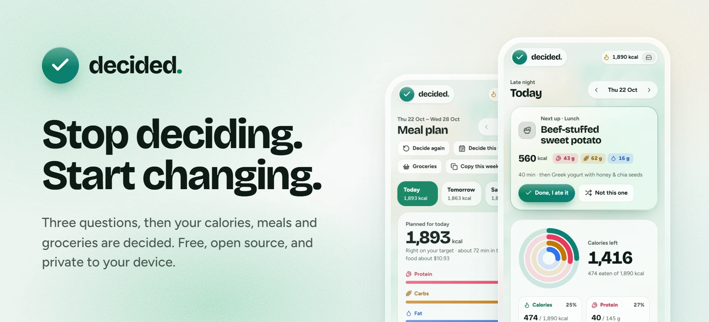
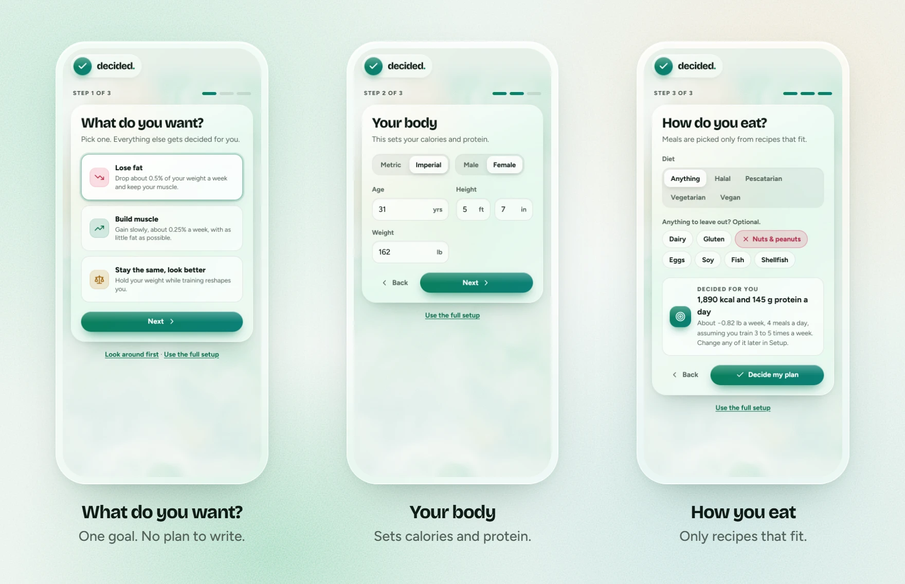
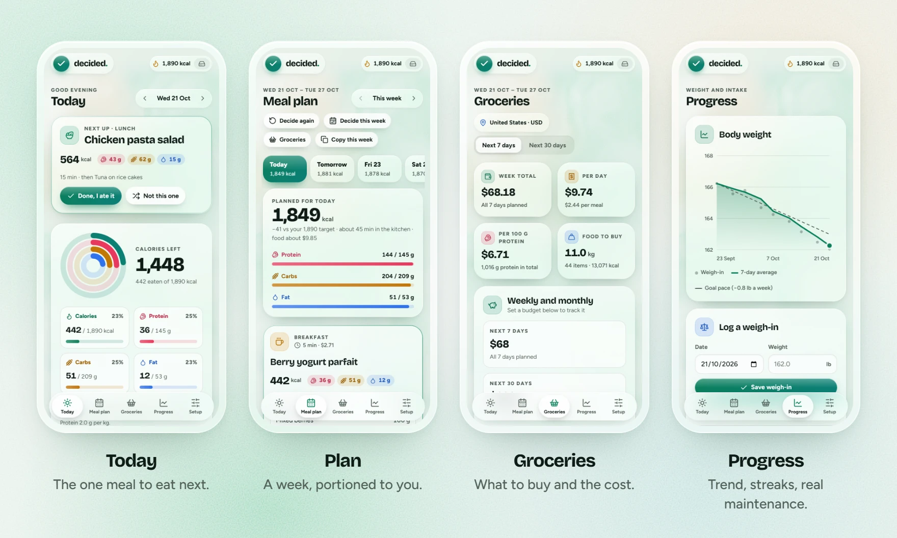
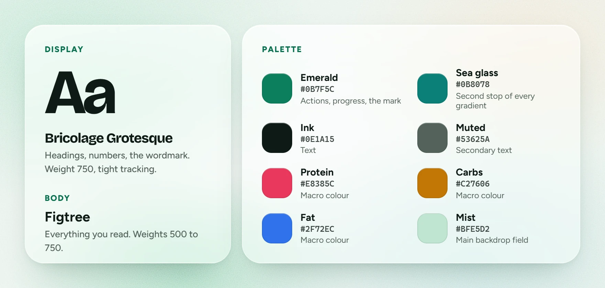

<picture>
  <source media="(prefers-color-scheme: dark)" srcset="docs/banner-dark.webp">
  
</picture>

  <a href="https://wesper-01.github.io/decided/"><b>Open the app</b></a>
  &nbsp;·&nbsp;
  <a href="app/README.md">Add it to your phone</a>
  &nbsp;·&nbsp;
  <a href="CONTRIBUTING.md">Contribute</a>

Most people who want to lose fat or build muscle already know roughly what to do. What stops them is the hundred small decisions in between: how much to eat, what to cook tonight, what to buy, whether today went well enough. Decided makes those decisions for you, so the only thing left is to follow the plan.

It is free and open source. It runs in the browser from one HTML file, with no account and no server, and your data stays on your device.

## Three questions, then it's decided

<picture>
  <source media="(prefers-color-scheme: dark)" srcset="docs/quick-start-dark.webp">
  
</picture>

Pick a goal, enter your age, height and weight, and say what you don't eat. Decided works out your calories and protein, plans the whole first week and shows you the first meal. Everything else starts on a sensible default (four meals a day, your country's prices, metric or imperial from your device) and can be changed later in Setup.

## What it decides

<picture>
  <source media="(prefers-color-scheme: dark)" srcset="docs/screens-dark.webp">
  
</picture>

- **Today** shows one thing: the next meal. Tap "Done, I ate it" or "Not this one". The rings fill as the day goes.
- **Plan** builds every day of the week from 43 recipes, each portioned to your targets. Swap a meal for one of five close alternatives, favourite recipes you want more often, hide the ones you never want.
- **Training days and batch cooking:** more food on the days you train and less on rest days, with the same weekly average. Lunches and dinners can be cooked once for two or three days.
- **Groceries** turns the plan into a shopping list for 7 or 30 days, with amounts, cost by aisle and by day, and an optional budget the planner fits the week into. Prices cover 39 countries and can be adjusted for your city or set by hand.
- **Progress** draws your weight trend, measures your real maintenance calories from your own logs, and keeps a streak and a five-week calendar.
- **The small things:** water, one-tap re-adding of recent foods, undo, and backup and restore as plain text.

## How the numbers are made

Targets start from the Mifflin-St Jeor equation, your activity level and your goal. Once you have logged at least 10 days of food in three weeks, plus some weigh-ins, Decided compares what you ate with how your weight moved and offers your measured maintenance in place of the formula. One tap switches your targets over.

Each recipe has protein, carb and fat ingredients. A box-constrained least-squares fit scales them so the day's meals add up to your targets, keeping every portion within sensible limits. The test suite checks that planned days land within 6% of calories and protein across six different bodies and goals.

## Use it

- **In a browser:** open <https://wesper-01.github.io/decided/>, or open `app/index.html` locally.
- **On a phone:** open the same link in Safari or Chrome and add it to your home screen. It works offline and opens full screen. [app/README.md](app/README.md) has the steps, and how to host your own copy.
- **On claude.ai:** `decided.html` also runs as a Claude artifact. There it syncs to your Claude account and can use Claude to suggest what to eat next, build a custom meal or estimate prices for your city. Everywhere else those features are hidden.

## Look and feel

<picture>
  <source media="(prefers-color-scheme: dark)" srcset="docs/look-dark.webp">
  
</picture>

Glass panels float over a slow emerald mist with a fine film grain. Headings and numbers are set in Bricolage Grotesque, everything else in Figtree. Emerald marks anything you can act on; protein, carbs and fat each keep one colour everywhere they appear. Light and dark follow your device.

All of it lives as tokens at the top of `decided.html`. The images in this README are drawn from those same tokens and real screenshots by `npm run images`.

## Develop

You need Node 18 or newer. There is nothing to install.

| Command | What it does |
| --- | --- |
| `npm test` | Checks the planner (macro accuracy, diets, batch cooking, calorie cycling, budgets, streaks, quick start, backups) and that every screen renders. |
| `npm run build` | Rebuilds `app/` from `decided.html`. |
| `npm run dev` | Serves `app/` at http://localhost:4819. Open `/__icons` there to redraw the app icons. |
| `npm run images` | Rebuilds `app/`, then redraws the README images in `docs/`. Needs Chrome or Edge. |

| Path | What it is |
| --- | --- |
| `decided.html` | The whole app: styles, food and recipe data, planner, views and the live background. Edit this. |
| `build.js` | Wraps `decided.html` into the installable web app: manifest, offline cache, home-screen settings. |
| `app/` | The built web app and its icons. Rebuild it after changing `decided.html`. |
| `tests/check.js` | The checks `npm test` runs, with no test framework. |
| `tools/` | The local server and icon drawer, and the README image script. |
| `docs/` | The README images. |

Every push to `main` runs the tests and publishes `app/` to GitHub Pages. Read [CONTRIBUTING.md](CONTRIBUTING.md) before opening a pull request.

## A note on nutrition

Food values and prices are typical averages, not measurements of what's in your kitchen. Decided is not medical advice. If you have a medical condition, are pregnant, or have a history of disordered eating, talk to a professional before changing how you eat.

## Licence

MIT, see [LICENSE](LICENSE). Icons are from Lucide (ISC). Fonts are Bricolage Grotesque and Figtree (SIL OFL 1.1), loaded from Google Fonts. See [THIRD_PARTY_NOTICES.md](THIRD_PARTY_NOTICES.md).
